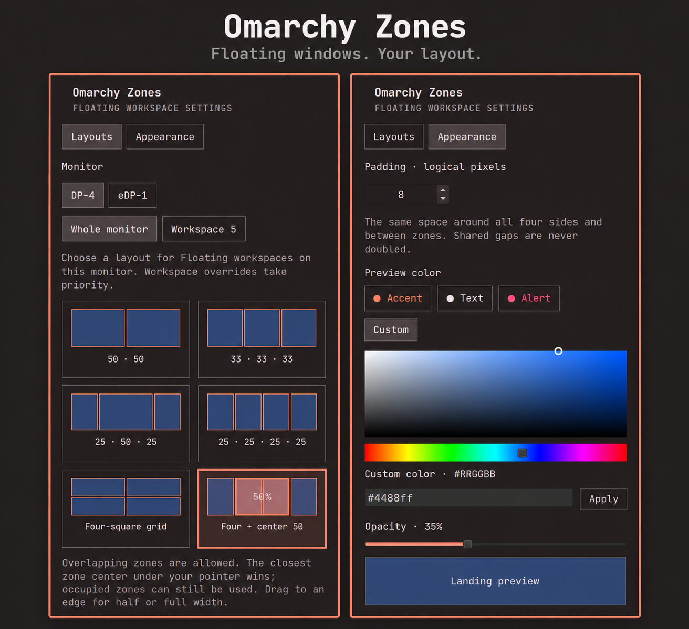

# Omarchy Zones

**Floating windows. Your layout.**

Zone snapping for Omarchy’s Floating workspace mode, with overlapping layouts,
consistent spacing and a translucent landing preview.



## Install

Requires **Omarchy Edge with Floating workspace mode**. Tested with Hyprland
0.56.2 and Quickshell 0.3.2; older Stable versions without this mode are not
supported.

```sh
omarchy plugin add https://github.com/austinwilkerson/omarchy-zones --enable
```

Accept Omarchy’s normal trust and placement prompts. Zones adds its bar icon,
builds its small native helper automatically on first start, then starts
snapping. Open the icon to see setup progress. Subsequent starts reuse the
compiled helper; a different running Hyprland ABI or updated helper source
selects a new build automatically.

The first build needs the normal Omarchy `base-devel` tools and the development
headers supplied by the installed Hyprland and its dependencies. No root setup,
input-group membership or separate build command is needed on the tested
Omarchy installation. A missing dependency or incompatible SDK produces an error
in the panel with a **Retry setup** button rather than silently enabling snapping.

## Choose a layout

Open **Zones → Layouts**, select a monitor, then choose **Whole monitor** or a
workspace override.

| Preset | Zones |
| --- | --- |
| 50 · 50 | Two equal columns |
| 50 · 50 vertical | Top and bottom halves |
| 33 · 33 · 33 | Three equal columns |
| 33 · 33 · 33 vertical | Top, middle and bottom rows |
| 25 · 50 · 25 | Wide center with narrow sides |
| 25 · 25 · 25 · 25 | Four equal columns |
| Four-square grid | Top-left, top-right, bottom-left and bottom-right |
| Four + center 50 | Four equal columns plus an overlapping middle half |

When zones overlap, the closest center among the zones containing the pointer
wins. Occupied zones remain available; existing windows can overlap. Workspace
overrides take priority and can be cleared with **Use inherited layout**.

Drag to the left or right monitor edge for a half-width window, or to the top
edge to fill the usable area. A window snaps when you release it, with the
landing preview showing its complete frame. Pausing during a drag does not snap,
and a resize gesture preserves its manual size.

Zones activates only in Omarchy’s saved **Floating workspace mode**. Individually
floated windows in Tiling or Scrolling workspaces do not activate it. Changing
settings affects the next snap; it does not rearrange existing windows.

## Make it yours

The **Appearance** tab provides:

- **Padding:** one value around all four sides and between adjacent zones.
  Shared gaps are never doubled, including odd values such as 5 pixels.
- **Preview color:** live theme Accent (default), Text or Alert, or a custom
  color using the embedded picker or `#RRGGBB` field.
- **Opacity:** 5–80%, with a default of 35%.

Calculations use logical pixels and include titlebars and borders. Each monitor
has its own usable area, accounting for scale, rotation, offset and bars on any
edge. Dock space is reserved conservatively in Floating mode, including an
available auto-hiding dock. A boundary check keeps visible floating windows clear
of bars and the dock without assigning them to a zone.

Preferences save automatically to
`~/.local/state/omarchy/zones/settings.json` (`$XDG_STATE_HOME` when set).
Compiled helpers and build logs live under `~/.cache/omarchy-zones/`
(`$XDG_CACHE_HOME` when set). Preferences are stored outside the plugin folder so
changing a slider does not cause Omarchy to reload the plugin.

## How it works

The bar widget owns one shared coordinator across monitors. Its Python backend
uses Hyprland IPC to read geometry and move windows. A small C++ helper runs
inside Hyprland and reports left/right mouse-button state through the existing
IPC socket. This makes release detection work with Omarchy’s titlebars, which
consume events before ordinary shortcuts can observe them.

The helper does not consume events, add keybindings, read input devices, record
keystrokes or send network requests. It is compiled locally and checks the
running compositor’s ABI before registering its event listener. Disabling Zones
stops its backend and unloads the helper it loaded. No compiled binaries are
shipped in the repository.

Build dependencies: C++23 compiler, `pkg-config`, and headers/libraries for
Hyprland, libinput, libudev, pixman, Wayland server, xkbcommon and libdrm. On Arch,
these come from `base-devel`, `hyprland`, `libinput`, `systemd-libs`, `pixman`,
`wayland`, `libxkbcommon` and `libdrm`, plus their dependencies.

## Update or remove

```sh
omarchy plugin update io.github.austinwilkerson.zones
omarchy plugin disable io.github.austinwilkerson.zones
omarchy plugin remove io.github.austinwilkerson.zones
```

Updates retain preferences and rebuild the helper when necessary. Removal leaves
your preferences and compiled cache available for a later reinstall; delete the
Zones-specific directories listed above if you want to clear them.

## Development and limits

This is an early public release, tested on a dual-monitor Omarchy Edge desktop.
Touchscreen-only dragging, other compositors and future incompatible Hyprland
SDKs are not validated. See [validation notes](VALIDATION.md) for test scope and
known limitations.

```sh
python3 -m unittest discover -s tests -v
omarchy plugin validate .
python3 zonesd.py --dry-run --monitor 4096x1152 --pointer 2000,700
```

`tests/verify_nested.py` performs opt-in checks in a disposable nested Hyprland.
For native helper development, `scripts/build-observer.sh /path/to/observer.so`
builds without loading it into the compositor.

[Original Layouts screenshot](docs/screenshots/layouts.png) ·
[Original Appearance screenshot](docs/screenshots/appearance.png)

MIT license. Issues and contributions are welcome.
